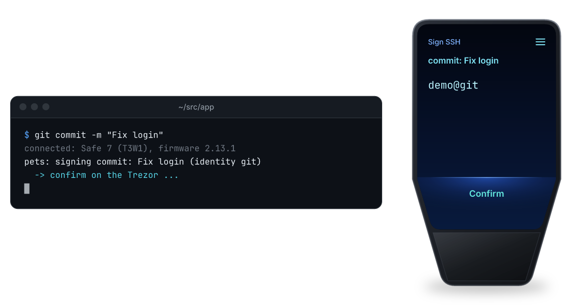
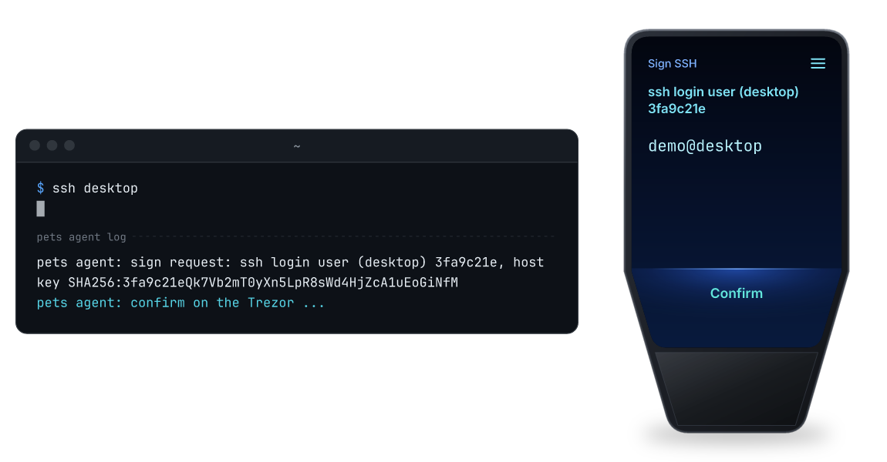
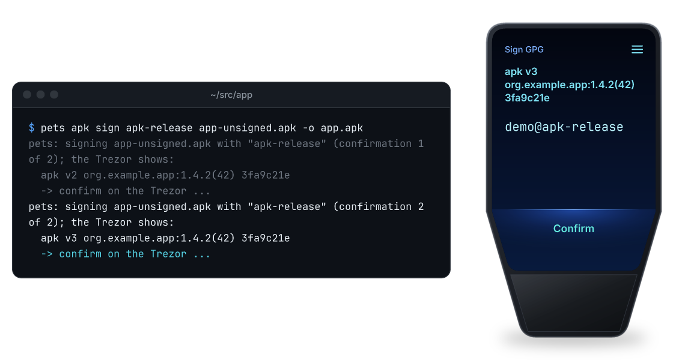

<p align="center">
  <!-- logo: variant B "Signet p"; alternatives in docs/img/logo/ (README.md there) -->
  
</p>

<h1 align="center">petschaft</h1>

`petschaft` (CLI: `pets`) signs git commits, SSH logins and Android APKs with a hardware wallet.
It works with the **Trezor Safe 7** (USB or Bluetooth): `pets` asks, the device shows what it signs, you confirm.
The private keys never leave the device.

<p align="center">
  <br>
  <em>git commit: the device shows the commit subject.</em>
</p>

<p align="center">
  <br>
  <em>SSH login: user, identity and the server's host key.</em>
</p>

<p align="center">
  <br>
  <em>APK signing: package, version and content digest.</em>
</p>

## Features

- Git commit and tag signing (SSH signatures), commit subject on the device
- SSH: an agent that signs only logins to pinned servers, plus FIDO2 hardware-only keys
- Android APK signing, scheme v2/v3, every APK verified with `apksigner`
- Private keys never leave the device
- NixOS and nix-darwin modules

Early software: the SSH agent and APK signing are so far tested with a software signer only.

## Install

As a flake input (modules: [docs/nix.md](docs/nix.md)):

```nix
inputs.petschaft.url = "github:zdrng/petschaft";
inputs.petschaft.inputs.nixpkgs.follows = "nixpkgs";
```

Or build it:

```bash
nix build github:zdrng/petschaft
./result/bin/pets --help
```

## Quickstart

Identities live in `~/.config/petschaft/config.toml`
([reference](docs/architecture.md#configuration)):

```toml
[[identity]]
name = "git"
uri = "ssh://demo@git"
curve = "ed25519"
passphrase = "standard"
```

`passphrase = "standard"` signs with the standard wallet, without a prompt; it works on
a factory Trezor. The default, `ask`, opens a new session and asks for a passphrase on
the device for every signature (a different passphrase gives different keys); it needs
passphrase protection enabled on the Trezor, which is off on a new device.

**git**

```bash
pets pubkey git > ~/.config/petschaft/git.pub   # pin the printed fingerprint
git config --global gpg.format ssh && git config --global gpg.ssh.program pets
git config --global user.signingkey "key::$(cat ~/.config/petschaft/git.pub)"
git config --global commit.gpgsign true
# verification (git log --show-signature): who may sign as which email
echo "$(git config user.email) $(cat ~/.config/petschaft/git.pub)" >> ~/.config/petschaft/allowed_signers
git config --global gpg.ssh.allowedSignersFile ~/.config/petschaft/allowed_signers
```

**ssh** ([docs/agent.md](docs/agent.md): `host_keys` and the `IdentityAgent` line)

```bash
pets pubkey desktop   # add the printed public_key line to the identity
pets pair             # once, then run `pets agent` or the module's service
ssh desktop
```

FIDO2 instead (an identity with `kind = "fido2"` and `algorithm = "ed25519-sk"`, USB only):

```bash
pets fido2 create homelab   # add the printed fingerprint = "..." line to the identity
pets sshd-config homelab    # authorized_keys line and sshd drop-in for the server
pets ssh homelab -- user@homelab
```

**apk** ([docs/apk.md](docs/apk.md): a `gpg://` identity with curve `nist256p1`)

```bash
pets apk init apk-release --subject "CN=Example Release"   # add the printed line(s)
pets apk sign apk-release app-unsigned.apk -o app.apk
pets apk verify app.apk
```

**Linux**: for Bluetooth, pair the Trezor once in the system Bluetooth dialog (or with
`bluetoothctl`). USB needs the Trezor udev rules, which the NixOS module installs
(`programs.petschaft.udev`, on by default; [docs/nix.md](docs/nix.md)).

## Security model

- Keys are derived on the device; petschaft stores no key material.
- Every signature needs a confirmation on the device. The device shows what the host sends: it catches unexpected requests, not a compromised computer that lies about them.
- Every signature from the device is verified locally, and against the pinned key; a mismatch aborts.
- The SSH agent refuses forwarded agents (`ssh -A`) and servers whose host key is not pinned.
- The pairing credential is kept only in the OS secret store, never in plaintext.

## Docs

[Architecture](docs/architecture.md) · [SSH agent](docs/agent.md) · [APK signing](docs/apk.md) · [Nix](docs/nix.md) · [Helper protocol](docs/helper-protocol.md) · [Testing](docs/testing.md) · [Contributing](CONTRIBUTING.md) · [Security](SECURITY.md)

## AI-generated

Most of this project (code, tests and documentation) was generated with AI. As with any open-source project, read the code before you trust it.

One thing does not depend on this code: private keys are created and kept inside the hardware wallet and cannot be exported by any software. What gets signed, however, is decided by this software and by what you confirm, so check the device's display before you confirm.

## License

Copyright (C) 2026 the petschaft contributors. GPL-3.0-or-later, see [LICENSE](LICENSE).

---

petschaft is an independent free software project and is not affiliated with or endorsed by SatoshiLabs. Trezor is a trademark of SatoshiLabs.
